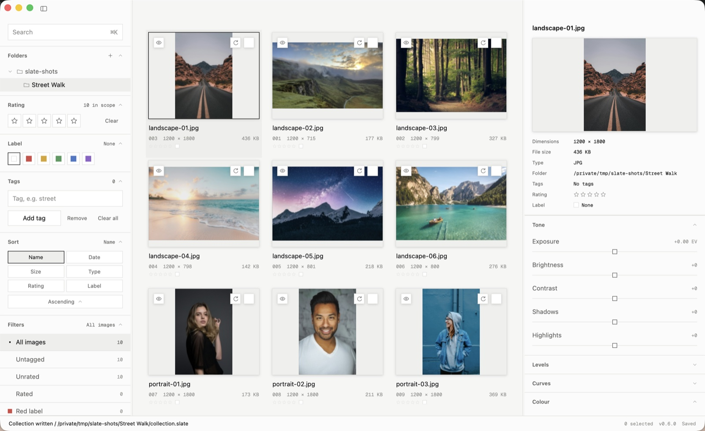
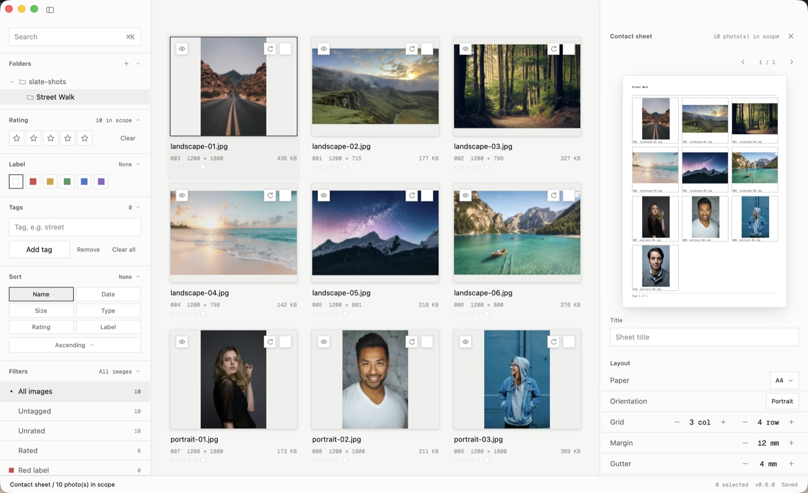
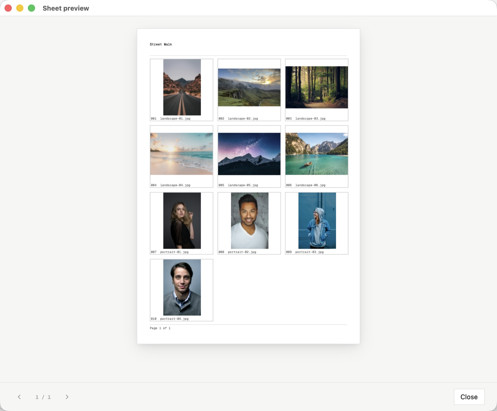
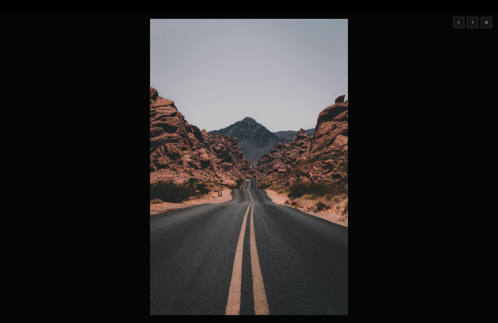
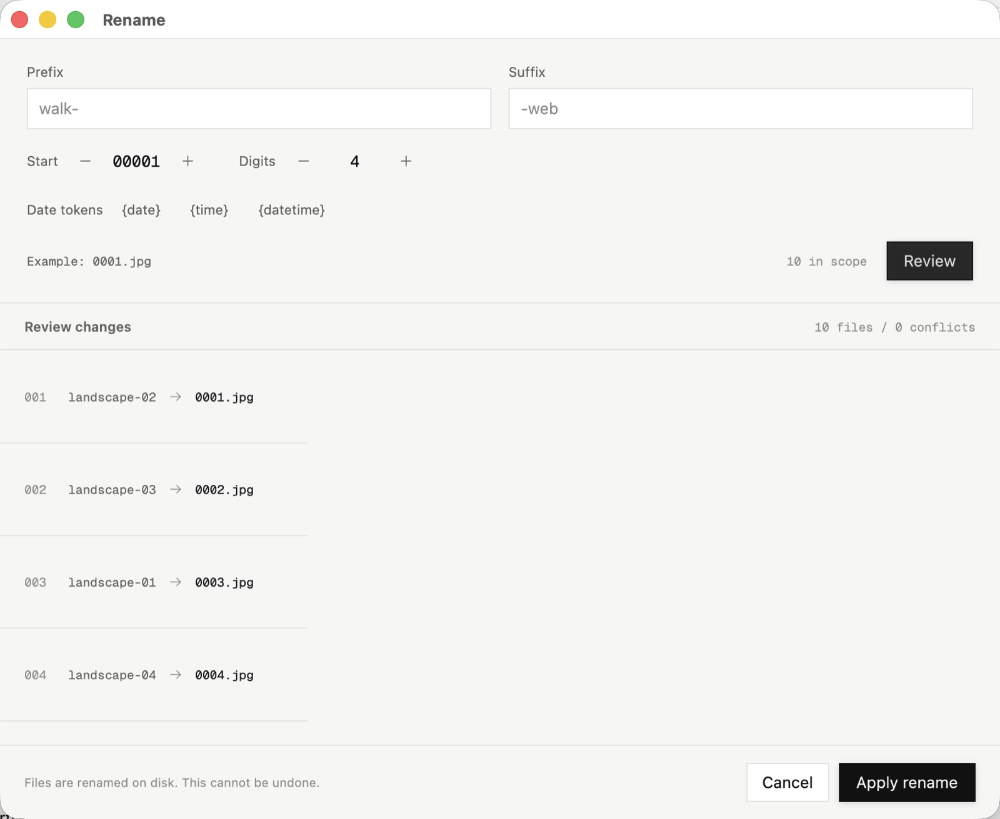
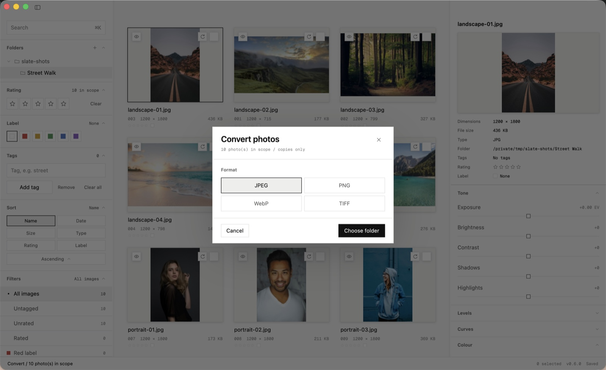
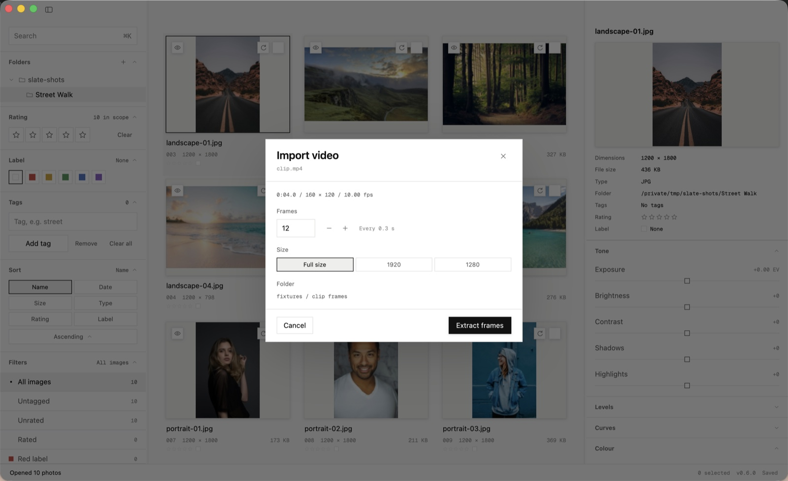
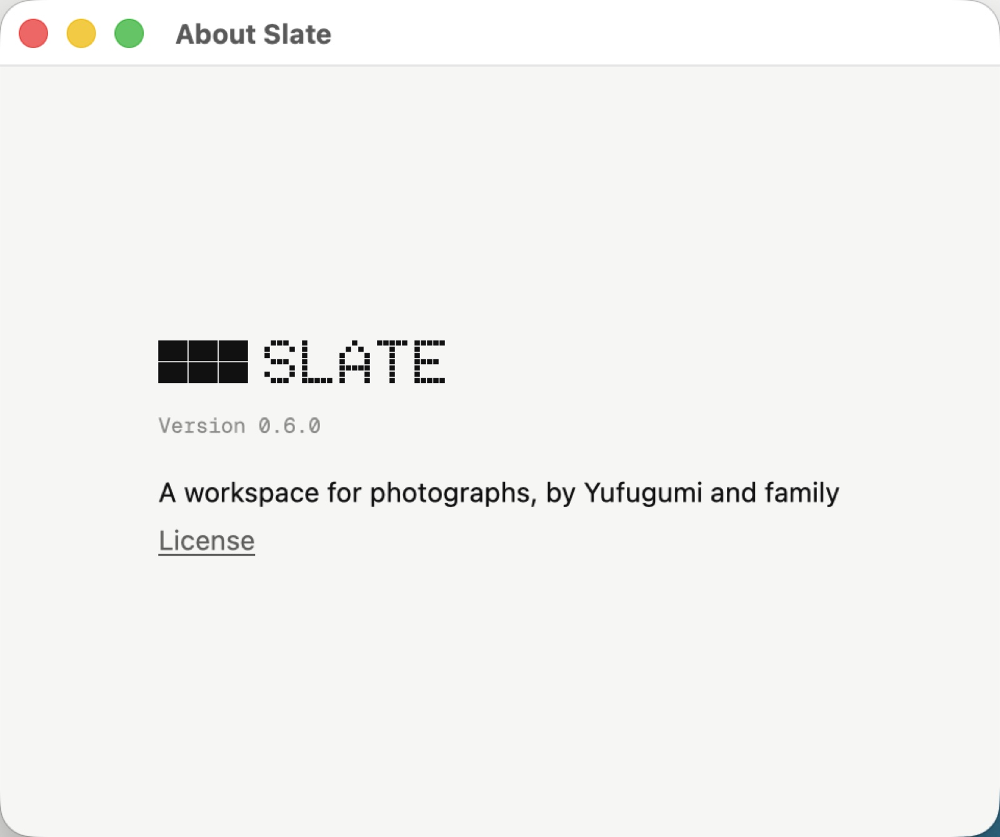

  <a href="https://tom.so/work/slate">Website</a>
  ·
  <a href="https://github.com/et0and/slate/releases">Releases</a>
  ·
  <a href="https://github.com/et0and/slate/issues">Issues</a>

Slate is a photography workflow tool. Process, rate, label, tag, convert, recolour and render contact sheets from your local folders or Google Drive. 

I designed Slate to be able to process through masses of old photographs from my art school days. I used to use Adobe Bridge until they took the contact sheet feature away, and then the equivalent automation action in Photoshop would routinely OOM my machine. This uses GPUI with performance and resource consumption in mind, so while it isn't as powerful as those aforementioned tools it is enough for me, and it might be for you too.  

## Screens

*Library and photo inspector.*

  
  

*Contact sheet builder and preview.*

  
  

*Full-screen review and batch rename.*

  
  

*Convert copies and extract video frames.*

  

*About Slate.*

## Keybindings

| Action | macOS | Windows and Linux |
| --- | --- | --- |
| Search | <kbd>⌘K</kbd> or <kbd>⌘F</kbd> | <kbd>Ctrl+K</kbd> or <kbd>Ctrl+F</kbd> |
| Open folder | <kbd>⌘O</kbd> | <kbd>Ctrl+O</kbd> |
| New collection | <kbd>⌘N</kbd> | <kbd>Ctrl+N</kbd> |
| Save collection / save as | <kbd>⌘S</kbd> / <kbd>⇧⌘S</kbd> | <kbd>Ctrl+S</kbd> / <kbd>Ctrl+Shift+S</kbd> |
| Import files / import folder | <kbd>⌘I</kbd> / <kbd>⇧⌘I</kbd> | <kbd>Ctrl+I</kbd> / <kbd>Ctrl+Shift+I</kbd> |
| Select all visible / deselect | <kbd>⌘A</kbd> / <kbd>⇧⌘D</kbd> | <kbd>Ctrl+A</kbd> / <kbd>Ctrl+Shift+D</kbd> |
| Undo / redo | <kbd>⌘Z</kbd> / <kbd>⇧⌘Z</kbd> | <kbd>Ctrl+Z</kbd> / <kbd>Ctrl+Shift+Z</kbd> |
| Rename | <kbd>⌘R</kbd> | <kbd>Ctrl+R</kbd> |
| Convert selected | <kbd>⇧⌘E</kbd> | <kbd>Ctrl+Shift+E</kbd> |
| Create contact sheet | <kbd>⇧⌘C</kbd> | <kbd>Ctrl+Shift+C</kbd> |
| Sheet preview | <kbd>⇧⌘P</kbd> | <kbd>Ctrl+Shift+P</kbd> |
| Export PDF | <kbd>⌘E</kbd> | <kbd>Ctrl+E</kbd> |
| Toggle left / right pane | <kbd>⌘B</kbd> / <kbd>⌥⌘B</kbd> | <kbd>Ctrl+B</kbd> / <kbd>Ctrl+Alt+B</kbd> |
| Previous / next in a preview | <kbd>←</kbd> / <kbd>→</kbd> | <kbd>←</kbd> / <kbd>→</kbd> |
| Close the topmost dialog or menu | <kbd>Esc</kbd> | <kbd>Esc</kbd> |

## Some naive benchmarks

On the latest build for macOS 26.5, Apple M5, 24 GB.

| Metric | Result |
| --- | ---: |
| Collection file size | 2.2 MB |
| Launch with a 10k collection | 0.2 s warm / 0.8 s cold |
| Memory, collection open | ~78 MB footprint |
| Metadata load | 5 ms |
| Plan an 834-page sheet | 3 ms |
| Rename plan, 10k files | 20 ms |
| Thumbnail cache | 32 images |

Slate draws the interface on the GPU with Metal on macOS, Direct3D 11
on Windows, and Vulkan on Linux. Linux uses Wayland when available and X11
otherwise. 

For reference, a 500k-photo collection mutation touches one chunk, snapshots
share the rest, and selection is a compact bitmap. It consumes
about 71 MB of memory before thumbnails and view caches.

## Installation

Download the latest build from [Releases](https://github.com/et0and/slate/releases):
a disk image for macOS, an `.exe` for Windows and an AppImage for Linux. Or
build Slate with Rust 1.99.1. It runs on macOS 11+, Windows 10/11, and Linux
with X11/Wayland.

## License and credits

Slate is licensed under the
[GNU General Public License v3.0](LICENSE). The Google Drive client uses the
MIT-licensed `google-drive` crate. Release builds include
[FFmpeg](https://ffmpeg.org), under the LGPL 2.1 or later, compiled from source
and linked statically.
