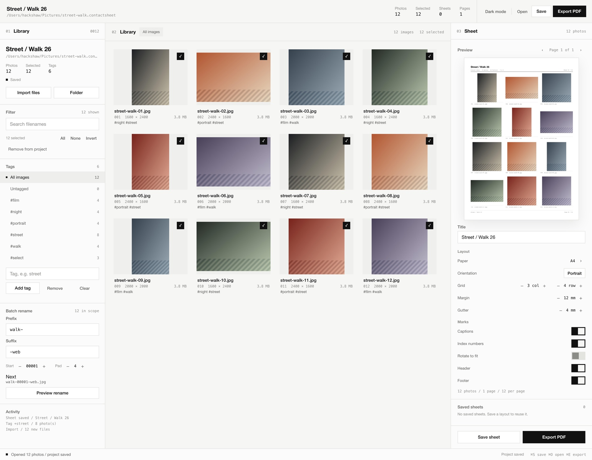
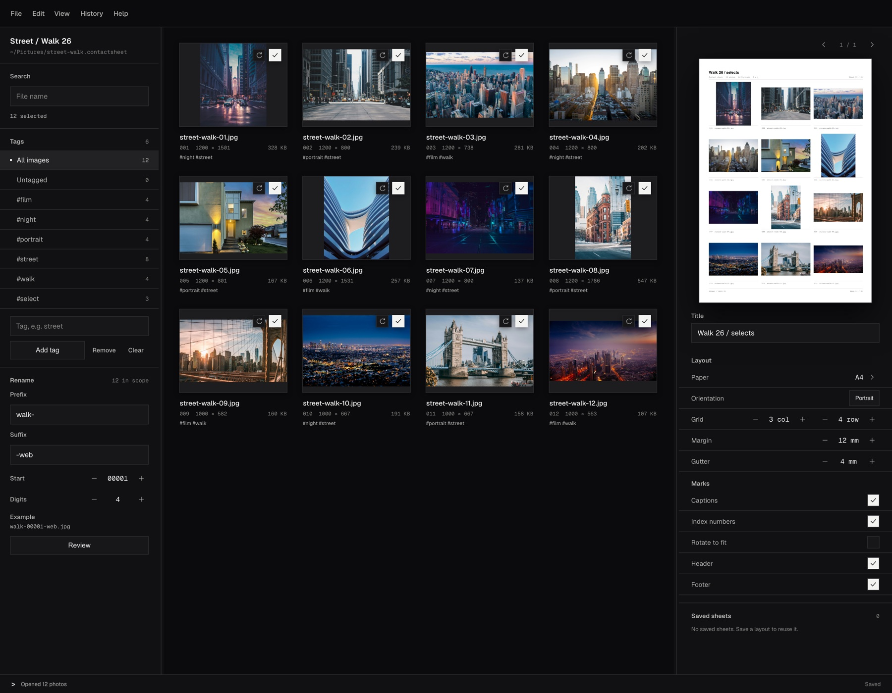
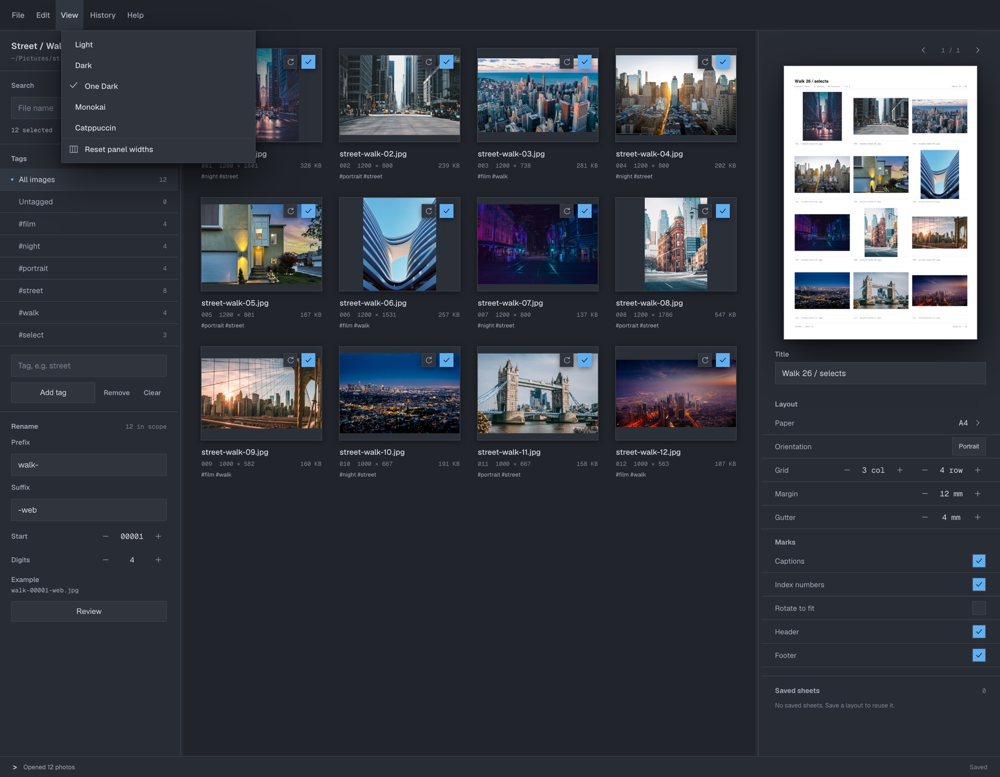

<h1 align="center">Slate</h1>

<p align="center">Photo management for the rest of us</p>

<p align="center">
  <a href="https://tom.so/work/slate">Website</a>
  ·
  <a href="https://github.com/et0and/slate">Source</a>
  ·
  <a href="https://github.com/et0and/slate/issues">Issues</a>
  ·
  <a href="docs/README.md">Docs</a>
</p>



Slate turns a folder of photos into a print-ready contact sheet. Save layouts/"slates" that you like for future projects as a .slate file. Import photos from your local storage, or connect your Google Drive account to add (more integrations coming). 

Use Slate for client proofs, portfolio edits, archive indexes, and the first pass through a shoot.

## Why Slate

- **Built for the cull.** Import folders or drops, search by name, tag, batch rename on disk, and rotate each frame from its thumbnail.
- **Fast on real libraries.** The grid is virtualised and only visible thumbnails load. A 10,000-photo project opens in about 0.2 seconds warm and stays around 137 MB.
- **Contact Sheet automation is not good enough.** On low powered machines, it is a known issue that this Photoshop batch automation is [incredibly buggy and resource intensive](https://www.reddit.com/r/photoshop/comments/vpwwn7/attempting_to_create_a_contact_sheet_that_uses/). 

## Benchmark

On the latest build for macOS 26.5, Apple M5, 24 GB.

| Metric | Result |
| --- | ---: |
| Project file size | 2.2 MB |
| Launch with a 10k project | 0.2 s warm / 0.8 s cold |
| Memory, project open | ~78 MB footprint |
| Metadata load | 5 ms |
| Plan an 834-page sheet | 3 ms |
| Rename plan, 10k files | 20 ms |
| Thumbnail cache | 32 images |

## Themes

Slate supports popular colour themes, with support for custom themes coming soon.

 

## Get started

Build Slate with Rust 1.99.1. It runs on macOS 11+, Windows 10/11, and Linux with X11/Wayland.

```sh
cargo run --release
cargo run --release -- ~/Pictures/project.slate
```

Then:

1. Drop in a folder of photos.
2. Tag selects, rotate frames, and tune the sheet.
3. Save the `.slate` project.
4. Export the PDF.

Verify:

```sh
cargo test --workspace
cargo clippy --workspace --all-targets -- -D warnings
```

## License and credits

Slate is licensed under the [GNU General Public License v3.0](LICENSE). Bundled Geist and Geist Mono are under the SIL Open Font License. Sample photographs are from Unsplash. SQLite is public domain.
