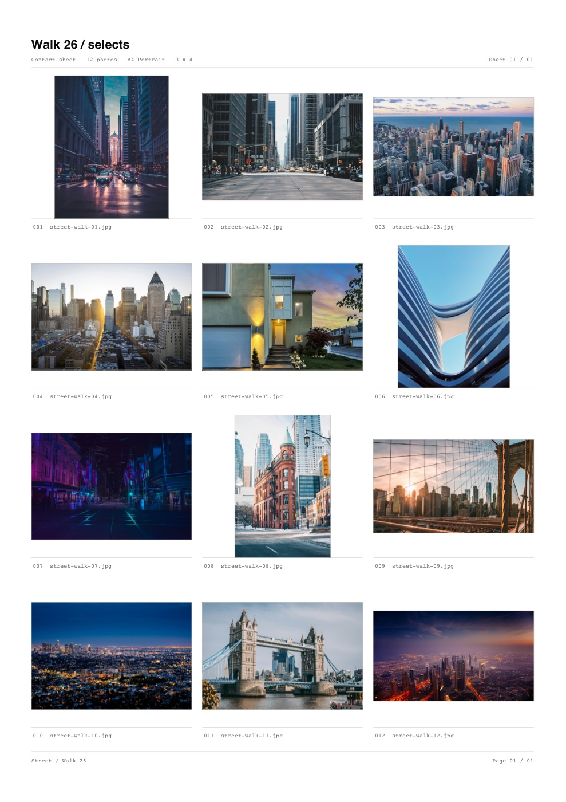
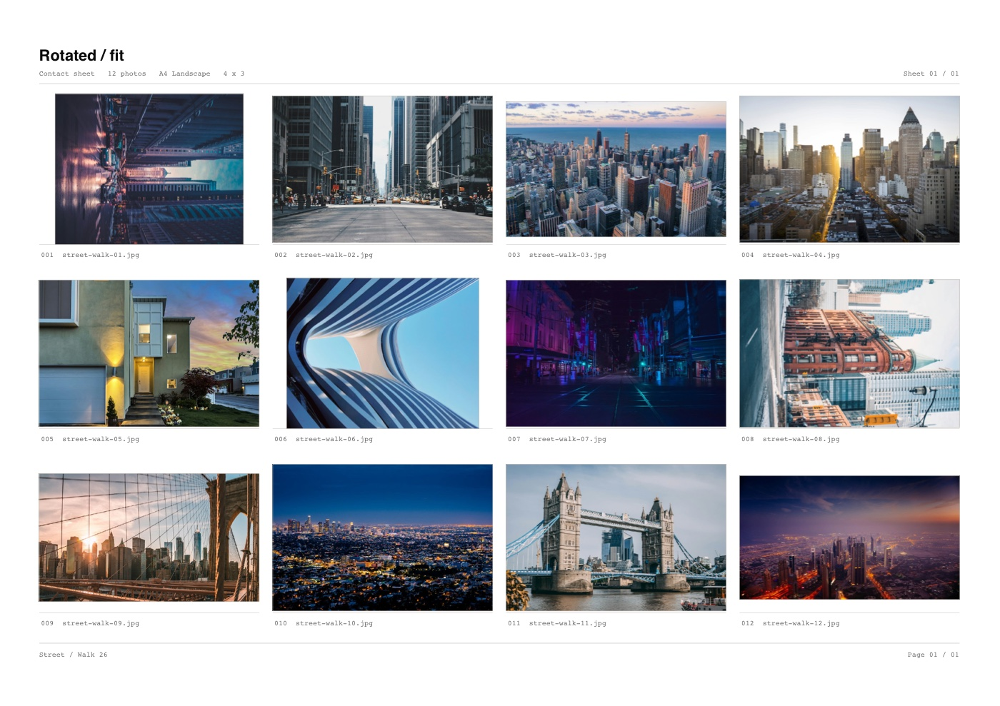

<h1 align="center">Slate</h1>

<p align="center">Contact sheets for photographers who want to get back to shooting.</p>

<p align="center">Local-first. Built in Rust. Print-ready.</p>

<p align="center">
  <a href="https://tom.so/work/slate">Website</a>
  ·
  <a href="https://github.com/et0and/slate-desktop">Source</a>
  ·
  <a href="https://github.com/et0and/slate-desktop/issues">Issues</a>
  ·
  <a href="docs/README.md">Docs</a>
</p>


Slate turns a folder of photos into a print-ready contact sheet. No upload, no account, no browser tab. Import a shoot, tag selects, rotate frames, and export a flat PDF. The `.slate` project stays portable; the photos stay where they are.

Use Slate for client proofs, portfolio edits, archive indexes, and the first pass through a shoot.

## Why Slate

- **Built for the cull.** Import folders or drops, search by name, tag, batch rename on disk, and rotate each frame from its thumbnail.
- **Fast on real libraries.** The grid is virtualised and only visible thumbnails load. A 10,000-photo project opens in about 0.2 seconds warm and stays around 137 MB.
- **Your files stay yours.** Slate reads originals in place. `.slate` files hold layout, tags, rotation, and saved sheets — never copies of your photos.
- **One sheet, no noise.** Five menus, five themes, zero toolbars. Commands live in File, Edit, View, History, and Help.
- **Print-ready by default.** A4, A3, Letter, and Tabloid sheets export as flat PDFs at up to 300 DPI per cell.
- **Undo that keeps up.** Every layout change is undoable without copying the whole library.

## Performance

A 10,000-photo project should not feel like a browser tab. Release build on macOS 26.5, Apple M5, 24 GB.

| Metric | Result |
| --- | ---: |
| Project file size | 2.2 MB |
| Launch with a 10k project | 0.2 s warm / 0.8 s cold |
| Memory, project open | ~137 MB |
| Metadata load | 5 ms |
| Plan an 834-page sheet | 3 ms |
| Rename plan, 10k files | 20 ms |
| Thumbnail cache | 256 images |

Export is on demand. At 12 up, 10,000 photos become 834 A4 pages.

Reproduce the core numbers with:

```sh
cargo run --release -p slate-core --example stress
```

## Interface

 

*Dark mode and the View menu. Themes: Light, Dark, One Dark, Monokai, Catppuccin.*

## Output



*A4 portrait, 3 × 4, 12 photos.*



*A4 landscape, 4 × 3, rotate-to-fit.*

## Get started

Build Slate with Rust 1.99.1. It runs on macOS 11+, Windows 10/11, and Linux with X11/Wayland.

```sh
cargo run --release
cargo run --release -- ~/Pictures/project.slate
```

Then:

1. Drop in a folder of photos.
2. Tag selects, rotate frames, and tune the sheet.
3. Save the `.slate` project.
4. Export the PDF.

Verify:

```sh
cargo test --workspace
cargo clippy --workspace --all-targets -- -D warnings
```

## License and credits

Slate is licensed under the [GNU General Public License v3.0](LICENSE). Bundled Geist and Geist Mono are under the SIL Open Font License. Sample photographs are from Unsplash. SQLite is public domain.
